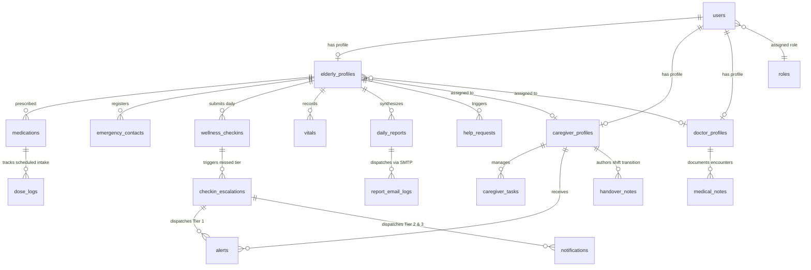

# HomeJoy — Database Design & Table Architecture
### MCA Final-Year Project | Technical Database Documentation
**System**: HomeJoy Assisted Living & Senior Healthcare Management System  
**Database Technology**: MongoDB Atlas (NoSQL Document Store)  
**ORM / Driver**: PyMongo (v4.x) with Pydantic v2 Schema Validation  
**Backend Framework**: FastAPI (Python 3.10+)  
**Document Classification**: Academic Project Final Report / System Architecture  

---

## 1. Executive Summary & Database Architecture

HomeJoy employs a **document-oriented NoSQL architecture** hosted on **MongoDB Atlas**, accessed through the Python **PyMongo** client driver within an asynchronous **FastAPI** backend. 

### Why MongoDB NoSQL for HomeJoy?
1. **Dynamic & Polymorphic Clinical Data**: Geriatric healthcare records feature highly polymorphic documents — residents may have variable chronic conditions, custom medication regimens, dynamic vitals baselines, and shifting care requirements that fit naturally into flexible JSON/BSON documents.
2. **Read-Heavy Dashboard Performance**: Caregiver and doctor command centers require immediate retrieval of consolidated resident snapshots. Denormalizing key metadata (such as `resident_name`, `caregiver_name`, and daily aggregated reports) avoids expensive multi-table joins.
3. **Time-Series & Telemetry Logging**: Daily check-ins, vitals measurements, dose logs, and audit trails represent time-stamped event streams that benefit from compound B-Tree indexing on `(user_id, date)`.
4. **Resilience & Scalability**: Cloud-native clustering on MongoDB Atlas provides TLS-secured network transport, automated failover, and non-blocking horizontal scale.

### High-Level Statistics
- **Total MongoDB Collections**: 20 collections (18 core active + 1 dynamic service collection + 1 legacy migration collection)
- **Primary Authentication Model**: Salted bcrypt password hashes within `users` collection with RBAC linkages in `roles`.
- **Indexing Strategy**: Production-verified idempotent indexing engine (`init_db_indexes`) covering unique email constraints, foreign key references, and compound sorting vectors.

---

## 2. Master Database Collection Inventory

| # | Collection Name | Functional Classification | Primary File Reference | Active Status | Purpose Summary |
|---|-----------------|---------------------------|------------------------|---------------|-----------------|
| 1 | `users` | Identity & Access | `app/database.py`, `app/models/user_model.py` | Active | Core credentials, role mapping, authentication status |
| 2 | `roles` | Identity & RBAC | `app/database.py`, `app/models/role_model.py` | Active | Role definitions and granular permission lists |
| 3 | `elderly_profiles` | Resident Care | `app/database.py`, `app/models/elderly_model.py` | Active | Senior demographic, medical baseline, guardian contact |
| 4 | `caregiver_profiles` | Staff Management | `app/database.py`, `app/models/caregiver_model.py` | Active | Professional credentials, assigned residents roster |
| 5 | `doctor_profiles` | Clinical Oversight | `app/database.py`, `app/models/doctor_model.py` | Active | Attending physician credentials, patient panel |
| 6 | `medications` | Medication Module | `app/database.py`, `app/schemas/elderly_client_schema.py` | Active | Resident prescription regimens, schedules, times |
| 7 | `dose_logs` | Medication Module | `app/database.py`, `app/services/medication_dose_service.py` | Active | Real-time dose intake audit, late tracking, adherence |
| 8 | `wellness_checkins` | Daily Telemetry | `app/database.py`, `app/schemas/elderly_client_schema.py` | Active | 6-dimension daily subjective wellness scores |
| 9 | `vitals` | Daily Telemetry | `app/database.py`, `app/schemas/vitals_schema.py` | Active | Objective BP and Oxygen Saturation telemetry |
| 10 | `daily_reports` | Reporting & Audits | `app/database.py`, `app/schemas/daily_report_schema.py` | Active | Aggregated daily resident digest for staff & family |
| 11 | `report_email_logs` | Reporting & Audits | `app/database.py`, `app/services/email_service.py` | Active | SMTP email transmission logs for guardian reports |
| 12 | `emergency_contacts` | Safety & Urgent Care | `app/database.py`, `app/schemas/elderly_client_schema.py` | Active | Primary and secondary emergency phone contacts |
| 13 | `help_requests` | Safety & Urgent Care | `app/database.py`, `app/schemas/help_request_schema.py` | Active | "Call Caregiver" / SOS assistance tickets |
| 14 | `alerts` | Clinical Alerts | `app/database.py`, `app/schemas/caregiver_portal_schema.py` | Active | Caregiver triage alerts (missed check-ins, vitals) |
| 15 | `caregiver_tasks` | Clinical Operations | `app/database.py`, `app/schemas/caregiver_portal_schema.py` | Active | Actionable caregiver operational tasks & checklists |
| 16 | `notifications` | System Messaging | `app/database.py`, `app/routers/admin.py` | Active | Role-targeted and system-wide broadcast alerts |
| 17 | `medical_notes` | Clinical Oversight | `app/database.py`, `app/schemas/doctor_schema.py` | Active | Doctor encounter diagnoses, notes, follow-up dates |
| 18 | `checkin_escalations` | Escalation Engine | `app/services/escalation_service.py` | Active | 3-tier escalation engine state for missed check-ins |
| 19 | `handover_notes` | Clinical Operations | `app/services/handover_service.py` | Active | Inter-shift caregiver clinical transition notes |
| 20 | `family_profiles` | Legacy Migration | `app/database.py`, `scripts/migrate_family_to_guardian.py` | Deprecated / Read | Preserved for legacy data migration to `elderly_profiles` |

---

## 3. Entity-Relationship & Data Flow Diagram



---

## 4. Comprehensive Collection Specifications

Each collection is documented below with its exact fields, BSON/Python data types, nullability, constraints, foreign relationships, and code file sources.

```
--------------------------------------------------------------------------------
1. COLLECTION: users
--------------------------------------------------------------------------------
```
* **Purpose**: Master authentication repository and user identity store for all system actors (Elderly, Caregivers, Doctors, Administrators).
* **Source Files**: `backend/app/database.py`, `backend/app/models/user_model.py`, `backend/app/schemas/user_schema.py`, `backend/app/routers/auth.py`.

| Field Name | Data Type | Nullable | Constraints / Enum | Description |
|------------|-----------|----------|-------------------|-------------|
| `_id` | `ObjectId` | No | Auto-generated PK | MongoDB internal document identifier |
| `name` / `full_name` | `string` | No | Min 2, Max 100 chars | Display and legal name of the user |
| `email` | `string` | No | Valid email format, lowercase | Unique login email address |
| `password` | `string` | No | Min 6 chars (bcrypt hash in DB) | Salted bcrypt encrypted password hash |
| `phone` | `string` | Yes | Valid phone string | Primary contact telephone number |
| `role` | `string` | No | `"Admin"`, `"Elderly"`, `"Caregiver"`, `"Doctor"` | Assigned role string linked to RBAC definitions |
| `status` | `string` | No | `"active"`, `"inactive"` | User account lifecycle state |
| `is_active` | `boolean` | No | Default: `true` | Boolean flag for fast access checks |
| `profileImage` | `string` | Yes | URL / Base64 string | User profile picture URI |
| `googleId` | `string` | Yes | OAuth token identifier | Third-party OAuth identity identifier (if used) |
| `createdAt` / `created_at` | `string` | No | ISO 8601 UTC timestamp | Record creation timestamp |
| `updatedAt` / `updated_at` | `string` | No | ISO 8601 UTC timestamp | Record modification timestamp |

* **Indexes**:
  1. `{"email": 1}` — `unique=True`, `sparse=True` (Enforces login uniqueness)
  2. `{"role": 1}` — Standard B-Tree (Optimizes role-filtered queries)
  3. `{"is_active": 1}` — Standard B-Tree (Optimizes active user scans)

---

```
--------------------------------------------------------------------------------
2. COLLECTION: roles
--------------------------------------------------------------------------------
```
* **Purpose**: System Role-Based Access Control (RBAC) catalog defining permission sets for administrative, medical, caregiving, and resident accounts.
* **Source Files**: `backend/app/database.py`, `backend/app/models/role_model.py`, `backend/app/schemas/role_schema.py`, `backend/app/services/role_service.py`.

| Field Name | Data Type | Nullable | Constraints / Enum | Description |
|------------|-----------|----------|-------------------|-------------|
| `_id` | `ObjectId` | No | Auto-generated PK | Primary Key |
| `role_name` | `string` | No | Unique (e.g. `"Admin"`) | Canonical system role name |
| `description` | `string` | No | Descriptive text | Role scope and operational responsibilities |
| `is_system_role` | `boolean` | No | Default: `true` | Prevents deletion or rename of foundational roles |
| `permissions` | `array[string]` | No | Permission slugs | Permitted actions (`users:read`, `vitals:write`, etc.) |
| `user_count` | `integer` | No | `>= 0`, default 0 | Cached count of active users holding this role |
| `createdAt` | `string` | Yes | ISO 8601 UTC timestamp | Timestamp of role registration |
| `updatedAt` | `string` | Yes | ISO 8601 UTC timestamp | Timestamp of permissions modification |

* **Indexes**:
  1. `{"role_name": 1}` — Unique index preventing duplicate role creation.

---

```
--------------------------------------------------------------------------------
3. COLLECTION: elderly_profiles
--------------------------------------------------------------------------------
```
* **Purpose**: Core profile and clinical baseline for registered elderly residents. Holds personal vitals history, chronic medical conditions, guardian/family contact details, and care team assignments.
* **Source Files**: `backend/app/database.py`, `backend/app/models/elderly_model.py`, `backend/app/schemas/elderly_schema.py`, `backend/app/schemas/elderly_client_schema.py`, `backend/app/services/elderly_client_service.py`.

| Field Name | Data Type | Nullable | Constraints / Allowed Values | Description |
|------------|-----------|----------|-----------------------------|-------------|
| `_id` | `ObjectId` | No | Auto-generated PK | Primary Key |
| `user_id` | `string` | No | FK -> `users._id` | Associated authentication user account ID |
| `name` / `full_name` | `string` | No | Min 2, Max 100 chars | Full name of the resident |
| `email` | `string` | No | Synced with `users.email` | Resident login email address |
| `phone` | `string` | Yes | Min 7 digits | Contact phone number |
| `date_of_birth` | `string` | Yes | `YYYY-MM-DD`, must be past | Resident birthdate |
| `age` | `integer` | Yes | 50 to 120 (computed server-side) | Current age computed dynamically from DOB |
| `gender` | `string` | Yes | `"Male"`, `"Female"`, `"Other"` | Gender identity |
| `blood_group` | `string` | Yes | `"A+"`, `"A-"`, `"B+"`, `"B-"`, `"AB+"`, `"AB-"`, `"O+"`, `"O-"`, `"Unknown"` | Blood classification group |
| `address` | `string` | Yes | Free text | Room number or residential home address |
| `profileImage` | `string` | Yes | URI / Base64 string | Resident photograph |
| `setup_complete` | `boolean` | No | Default: `false` | Indicates whether onboarding wizard was finished |
| `conditions` | `array[string]` | Yes | Allowed: `"Diabetes"`, `"Blood Pressure"`, `"Heart Problem"`, `"Arthritis"`, `"Asthma"`, `"Thyroid"`, `"Kidney Problem"`, `"Other"`, `"None"` | Diagnosed chronic ailments |
| `other_condition` | `string` | Yes | Max 200 chars | Free-text condition when `"Other"` is selected |
| `allergies` | `array[string]` | Yes | List of allergens | Known drug, food, or environmental allergies |
| `previous_conditions` | `string` | Yes | Max 500 chars | Surgeries, hospitalizations, or medical history |
| `medical_notes` | `string` | Yes | Max 1000 chars | General clinical notes |
| `hospital_name` | `string` | Yes | Max 200 chars | Preferred tertiary care hospital |
| `hospital_location` | `string` | Yes | Max 300 chars | Address/city of preferred hospital |
| `hospital_department` | `string` | Yes | Max 200 chars | Specialty department (e.g. Cardiology) |
| `hospital_contact` | `string` | Yes | Valid phone string | Emergency desk phone for hospital |
| `guardian_name` | `string` | Yes | 2 to 100 chars, no newlines | Primary family guardian contact name |
| `guardian_relationship` | `string` | Yes | Max 50 chars (Son, Daughter, etc.) | Relationship of guardian to resident |
| `guardian_phone` | `string` | Yes | 7 to 15 digits | Guardian telephone number |
| `guardian_email` | `string` | Yes | Max 254 chars, valid email | Guardian email for daily health dispatches |
| `guardian_report_consent` | `boolean` | No | Default: `false` | Explicit legal consent to send health reports |
| `guardian_report_enabled` | `boolean` | No | Default: `true` | Toggles automatic daily report email dispatch |
| `assigned_caregiver_id` | `string` | Yes | FK -> `caregiver_profiles._id` | Assigned primary caregiver identifier |
| `assigned_caregiver_name` | `string` | Yes | Denormalized string | Cache of caregiver name for read performance |
| `assigned_doctor_id` | `string` | Yes | FK -> `doctor_profiles._id` | Assigned attending physician identifier |
| `assigned_doctor_name` | `string` | Yes | Denormalized string | Cache of doctor name for read performance |
| `risk_level` | `string` | No | `"Low"`, `"Moderate"`, `"High"` | Current clinical triage risk tier |
| `notification_prefs` | `object` | Yes | `{"checkin_reminder": bool, "medication_reminder": bool}` | Push/in-app notification toggles |
| `is_active` | `boolean` | No | Default: `true` | Active status indicator |
| `createdAt` / `created_at` | `string` | No | ISO 8601 UTC timestamp | Record creation timestamp |
| `updatedAt` / `updated_at` | `string` | No | ISO 8601 UTC timestamp | Record update timestamp |

* **Indexes**:
  1. `{"user_id": 1}` — B-Tree (High-performance 1-to-1 lookup from logged in session)
  2. `{"assigned_caregiver_id": 1}` — B-Tree (Used for caregiver resident roster aggregation)

---

```
--------------------------------------------------------------------------------
4. COLLECTION: caregiver_profiles
--------------------------------------------------------------------------------
```
* **Purpose**: Professional profile, clinical certifications, operational shift schedule, and resident roster for nursing staff.
* **Source Files**: `backend/app/database.py`, `backend/app/models/caregiver_model.py`, `backend/app/schemas/caregiver_schema.py`, `backend/app/schemas/caregiver_portal_schema.py`.

| Field Name | Data Type | Nullable | Constraints / Enum | Description |
|------------|-----------|----------|-------------------|-------------|
| `_id` | `ObjectId` | No | Auto-generated PK | Primary Key |
| `user_id` | `string` | No | FK -> `users._id` | Associated authentication user account ID |
| `name` / `full_name` | `string` | No | Min 2, Max 100 chars | Caregiver professional name |
| `email` | `string` | No | Valid email | Caregiver contact email |
| `phone` | `string` | Yes | Valid phone string | Emergency staff telephone |
| `qualification` | `string` | No | e.g. "Certified Nursing Assistant (CNA)" | Certified nursing or healthcare credentials |
| `experience_years` | `integer` | No | 0 to 40 years | Years of professional eldercare experience |
| `shift` | `string` | No | `"Day"`, `"Night"`, `"Rotational"` | Current operational duty shift |
| `status` | `string` | No | `"Active"`, `"On Leave"`, `"Inactive"` | Operational availability state |
| `assigned_elderly_ids` | `array[string]` | No | FKs -> `elderly_profiles._id` | Array of assigned elderly resident IDs |
| `assigned_elderly_names` | `array[string]` | Yes | Denormalized strings | Cached names of assigned residents |
| `daily_reports_submitted` | `integer` | No | `>= 0`, default 0 | Running total of clinical shift reports submitted |
| `performance_rating` | `float` | No | 0.0 to 5.0 (default 4.8) | Supervisory clinical performance rating |
| `profileImage` | `string` | Yes | URI / Base64 string | Caregiver photo |
| `createdAt` | `string` | Yes | ISO 8601 UTC timestamp | Record creation timestamp |
| `updatedAt` | `string` | Yes | ISO 8601 UTC timestamp | Record modification timestamp |

* **Indexes**:
  1. `{"user_id": 1}` — B-Tree (1-to-1 account lookup)
  2. `{"assigned_elderly_ids": 1}` — Multi-key B-Tree (Caregiver assignment scans)

---

```
--------------------------------------------------------------------------------
5. COLLECTION: doctor_profiles
--------------------------------------------------------------------------------
```
* **Purpose**: Attending physician profiles, hospital affiliations, medical council licenses, and assigned elderly patient panels.
* **Source Files**: `backend/app/database.py`, `backend/app/models/doctor_model.py`, `backend/app/schemas/doctor_schema.py`, `backend/app/services/doctor_service.py`.

| Field Name | Data Type | Nullable | Constraints / Enum | Description |
|------------|-----------|----------|-------------------|-------------|
| `_id` | `ObjectId` | No | Auto-generated PK | Primary Key |
| `user_id` | `string` | No | FK -> `users._id` | Associated authentication user account ID |
| `name` / `full_name` | `string` | No | Min 2, Max 100 chars | Doctor professional title and name |
| `email` | `string` | No | Valid email | Clinical email address |
| `phone` | `string` | Yes | Valid phone string | Clinical desk / pager phone number |
| `specialization` | `string` | No | e.g. "Geriatrician", "Cardiologist" | Medical specialty domain |
| `license_number` | `string` | No | Medical license code | State or National Medical Council license |
| `hospital_affiliation` | `string` | Yes | Hospital name | Affiliated medical institution / facility |
| `experience_years` | `integer` | No | 0 to 50 years | Years in active medical practice |
| `status` | `string` | No | `"Active"`, `"Inactive"` | Medical panel participation status |
| `assigned_patient_ids` | `array[string]` | No | FKs -> `elderly_profiles._id` | Array of elderly patient profile IDs |
| `assigned_patient_names` | `array[string]` | Yes | Denormalized strings | Cached patient names |
| `appointments_count` | `integer` | No | `>= 0`, default 0 | Number of consultations booked |
| `profileImage` | `string` | Yes | URI string | Physician profile photograph |
| `createdAt` | `string` | Yes | ISO 8601 UTC timestamp | Record creation timestamp |
| `updatedAt` | `string` | Yes | ISO 8601 UTC timestamp | Record modification timestamp |

---

```
--------------------------------------------------------------------------------
6. COLLECTION: medications
--------------------------------------------------------------------------------
```
* **Purpose**: Active prescription regimens, dosing schedules, food timing directives, and validity windows for elderly residents.
* **Source Files**: `backend/app/database.py`, `backend/app/schemas/elderly_client_schema.py`, `backend/app/services/medication_dose_service.py`.

| Field Name | Data Type | Nullable | Constraints / Enum | Description |
|------------|-----------|----------|-------------------|-------------|
| `_id` | `ObjectId` | No | Auto-generated PK | Primary Key |
| `user_id` | `string` | No | FK -> `users._id` | Associated resident user ID |
| `medicine_name` | `string` | No | Min 1, Max 200 chars | Brand or generic name of drug (e.g. "Metformin") |
| `dosage` | `string` | No | Min 1, Max 100 chars | Dose strength (e.g. "500mg", "1 tablet") |
| `frequency` | `string` | No | Allowed cadence string | e.g. "Once daily", "Twice daily", "Every 8 hours" |
| `intake_time` | `string` | Yes | Max 100 chars (legacy) | Human-readable time slot (e.g. "8:00 AM, 8:00 PM") |
| `times` | `array[string]` | No | 24h `HH:MM`, max 6 items | Normalized daily intake schedule (e.g. `["08:00", "20:00"]`) |
| `days_of_week` | `array[int]` | No | 0 to 6 (0=Mon, 6=Sun) | Weekly recurrence mask (default `[0,1,2,3,4,5,6]`) |
| `before_food` | `boolean` | No | Default: `true` | Timing directive (`true` = Before food, `false` = After food) |
| `prescribed_by` | `string` | Yes | Max 200 chars | Physician who authored the prescription |
| `start_date` | `string` | No | `YYYY-MM-DD` | Regimen commencement date |
| `end_date` | `string` | Yes | `YYYY-MM-DD`, `>= start_date` | Regimen expiration date |
| `created_at` | `string` | No | ISO 8601 UTC timestamp | Record creation timestamp |
| `updated_at` | `string` | No | ISO 8601 UTC timestamp | Record update timestamp |

* **Indexes**:
  1. `{"user_id": 1}` — B-Tree (Rapid retrieval of resident's active medicine cabinet)

---

```
--------------------------------------------------------------------------------
7. COLLECTION: dose_logs
--------------------------------------------------------------------------------
```
* **Purpose**: Smart Pill Tracker event ledger. Implements immutable audit logging for scheduled medication doses, tracking intake timeliness, late minutes, and missed doses.
* **Source Files**: `backend/app/database.py`, `backend/app/schemas/elderly_client_schema.py`, `backend/app/services/medication_dose_service.py`.

| Field Name | Data Type | Nullable | Constraints / Enum | Description |
|------------|-----------|----------|-------------------|-------------|
| `_id` | `ObjectId` | No | Auto-generated PK | Primary Key |
| `med_id` | `string` | No | FK -> `medications._id` | Associated medication prescription identifier |
| `user_id` | `string` | No | FK -> `users._id` | Resident user identifier |
| `medicine_name` | `string` | No | Denormalized string | Drug name snapshot at time of event |
| `dosage` | `string` | Yes | Denormalized string | Dosage strength snapshot |
| `scheduled_date` | `string` | No | `YYYY-MM-DD` | Target intake date |
| `scheduled_time` | `string` | No | 24h `HH:MM` | Target scheduled time slot |
| `status` | `string` | No | `"taken"`, `"missed"`, `"skipped"`, `"taken_late"` | Ingestion confirmation outcome |
| `taken_at` | `string` | Yes | ISO 8601 UTC timestamp | Exact timestamp user confirmed medication |
| `late_minutes` | `integer` | Yes | `>= 0`, default 0 | Delay in minutes past the scheduled window |
| `source` | `string` | Yes | e.g. "elderly_portal" | Channel through which dose intake was recorded |
| `created_at` | `string` | No | ISO 8601 UTC timestamp | Record creation timestamp |
| `updated_at` | `string` | No | ISO 8601 UTC timestamp | Record modification timestamp |

* **Indexes**:
  1. `[("med_id", 1), ("scheduled_date", 1), ("scheduled_time", 1)]` — `unique=True` (Guarantees no duplicate dose slots can be created on the same calendar day)
  2. `[("user_id", 1), ("scheduled_date", 1)]` — Compound B-Tree (Used for fast daily schedule queries)
  3. `{"status": 1}` — Standard B-Tree (Adherence rate calculations)

---

```
--------------------------------------------------------------------------------
8. COLLECTION: wellness_checkins
--------------------------------------------------------------------------------
```
* **Purpose**: Daily subjective wellness evaluations covering 6 holistic quality-of-life dimensions. Serves as primary input to the Explainable AI triage engine.
* **Source Files**: `backend/app/database.py`, `backend/app/schemas/elderly_client_schema.py`, `backend/app/services/wellness_score_service.py`.

| Field Name | Data Type | Nullable | Constraints / Allowed Values | Description |
|------------|-----------|----------|-----------------------------|-------------|
| `_id` | `ObjectId` | No | Auto-generated PK | Primary Key |
| `user_id` | `string` | No | FK -> `users._id` | Associated resident user account ID |
| `date` | `string` | No | Valid `YYYY-MM-DD` | Calendar date of check-in |
| `medication_taken` | `string` | No | `"Yes, all taken"`, `"Yes, partially taken"`, `"No, not taken"`, `"No medication today"` | Self-reported pill compliance |
| `appetite` | `string` | No | `"Excellent"`, `"Good"`, `"Fair"`, `"Poor"`, `"No Appetite"` | Daily nutritional interest level |
| `sleep_quality` | `string` | No | `"Excellent"`, `"Good"`, `"Fair"`, `"Poor"`, `"Very Poor"` | Nocturnal rest quality |
| `mobility_difficulty`| `string` | No | `"No difficulty"`, `"Slight difficulty"`, `"Moderate difficulty"`, `"Significant difficulty"` | Physical movement status |
| `mood` | `string` | No | `"Great"`, `"Good"`, `"Okay"`, `"Not Great"`, `"Poor"` | Emotional state indicator |
| `symptoms` | `string` | Yes | Max 500 chars | Free-text self-reported symptoms |
| `notes` | `string` | Yes | Max 1000 chars | Additional personal observations |
| `wellness_risk` | `string` | No | `"Low"`, `"Moderate"`, `"High"` | Computed triage classification |
| `contributing_factors`| `array[string]`| Yes | Array of risk indicators | AI risk drivers identified by rules engine |
| `baseline_comparison`| `string` | Yes | Text explanation | Deviation from resident's 7-day baseline |
| `engine_note` | `string` | Yes | Text | Audit remark from rule evaluation engine |
| `created_at` | `string` | No | ISO 8601 UTC timestamp | Submission timestamp |

* **Indexes**:
  1. `[("user_id", 1), ("date", -1)]` — Compound Descending B-Tree (Provides instant chronological check-in history)

---

```
--------------------------------------------------------------------------------
9. COLLECTION: vitals
--------------------------------------------------------------------------------
```
* **Purpose**: Objective physiological biometric telemetry: Systolic/Diastolic Blood Pressure and SpO2 Oxygen Saturation.
* **Source Files**: `backend/app/database.py`, `backend/app/schemas/vitals_schema.py`, `backend/app/services/vitals_service.py`.

| Field Name | Data Type | Nullable | Constraints / Allowed Values | Description |
|------------|-----------|----------|-----------------------------|-------------|
| `_id` | `ObjectId` | No | Auto-generated PK | Primary Key |
| `user_id` | `string` | No | FK -> `users._id` | Resident user identifier |
| `elderly_id` | `string` | Yes | FK -> `elderly_profiles._id` | Resident profile identifier |
| `date` | `string` | No | `YYYY-MM-DD` | Date of reading capture |
| `systolic` | `integer` | No | 50 to 250 mmHg | Systolic blood pressure |
| `diastolic` | `integer` | No | 30 to 150 mmHg, `< systolic` | Diastolic blood pressure |
| `oxygen_saturation`| `integer` | No | 50 to 100 % | SpO2 pulse oximetry percentage |
| `advisory_notes` | `string` | Yes | Non-diagnostic text | System-generated health advisory note |
| `created_at` | `string` | No | ISO 8601 UTC timestamp | Capture timestamp |
| `updated_at` | `string` | No | ISO 8601 UTC timestamp | Modification timestamp |

* **Indexes**:
  1. `[("user_id", 1), ("date", -1)]` — Compound Descending B-Tree (Supports rapid telemetry chart rendering)

---

```
--------------------------------------------------------------------------------
10. COLLECTION: daily_reports
--------------------------------------------------------------------------------
```
* **Purpose**: Synthesized end-of-day health digest consolidating check-ins, vitals, medication adherence, explainable risk calculations, and caregiver notes. Dispatched to family guardians.
* **Source Files**: `backend/app/database.py`, `backend/app/schemas/daily_report_schema.py`, `backend/app/services/daily_report_service.py`.

| Field Name | Data Type | Nullable | Constraints / Enum | Description |
|------------|-----------|----------|-------------------|-------------|
| `_id` | `ObjectId` | No | Auto-generated PK | Primary Key |
| `user_id` | `string` | No | FK -> `users._id` | Resident user account ID |
| `elderly_id` | `string` | No | FK -> `elderly_profiles._id` | Resident profile ID |
| `elderly_name` | `string` | No | Denormalized string | Resident full name |
| `date` | `string` | No | `YYYY-MM-DD` | Calendar date represented |
| `status` | `string` | No | `"Complete"`, `"Pending"` | Report completion status |
| `checkin_completed` | `boolean` | No | Boolean flag | Whether subjective check-in was logged |
| `vitals_completed` | `boolean` | No | Boolean flag | Whether physiological vitals were logged |
| `medication_adherence`| `string` | Yes | e.g. "100%", "2/3 Taken" | Adherence percentage summary |
| `checkin_data` | `object` | Yes | Embedded Document | Snapshot of `wellness_checkins` record |
| `vitals_data` | `object` | Yes | Embedded Document | Snapshot of `vitals` record |
| `wellness_risk` | `string` | No | `"Low"`, `"Moderate"`, `"High"` | Overall composite daily risk score |
| `explainable_risk` | `object` | Yes | Embedded Document | Confidence score, factor breakdown, disclaimer |
| `assigned_caregiver_id` | `string`| Yes | FK -> `caregiver_profiles._id` | Staff member in charge |
| `assigned_caregiver_name`| `string`| Yes | Denormalized string | Staff name |
| `generated_at` | `string` | No | ISO 8601 UTC timestamp | Report compilation timestamp |
| `updated_at` | `string` | No | ISO 8601 UTC timestamp | Report recalculation timestamp |

* **Indexes**:
  1. `[("user_id", 1), ("date", -1)]` — Compound B-Tree (Historical report archive queries)

---

```
--------------------------------------------------------------------------------
11. COLLECTION: report_email_logs
--------------------------------------------------------------------------------
```
* **Purpose**: Compliance and audit delivery tracking for SMTP automated and manual daily health report emails sent to family guardians.
* **Source Files**: `backend/app/database.py`, `backend/app/services/email_service.py`, `backend/app/services/report_scheduler.py`.

| Field Name | Data Type | Nullable | Constraints / Enum | Description |
|------------|-----------|----------|-------------------|-------------|
| `_id` | `ObjectId` | No | Auto-generated PK | Primary Key |
| `resident_id` | `string` | No | FK -> `elderly_profiles._id` | Resident subject of the report |
| `resident_name` | `string` | No | Text string | Resident name |
| `guardian_email` | `string` | No | Valid email | Recipient guardian email address |
| `guardian_name` | `string` | No | Text string | Recipient guardian full name |
| `report_date` | `string` | No | `YYYY-MM-DD` | Date of the delivered health report |
| `delivery_status` | `string` | No | `"sent"`, `"failed"`, `"skipped_no_consent"`, `"skipped_unconfigured"` | SMTP dispatch outcome |
| `error_message` | `string` | Yes | Text string | Error diagnostics if transmission failed |
| `dispatch_type` | `string` | No | `"automated_scheduler"`, `"manual_trigger"` | Trigger mechanism |
| `sent_at` | `string` | Yes | ISO 8601 UTC timestamp | Exact transmission timestamp |
| `created_at` | `string` | No | ISO 8601 UTC timestamp | Log entry creation timestamp |

---

```
--------------------------------------------------------------------------------
12. COLLECTION: emergency_contacts
--------------------------------------------------------------------------------
```
* **Purpose**: Priority emergency contacts registry for residents. Used by caregivers during urgent crises and automated Tier 3 escalation.
* **Source Files**: `backend/app/database.py`, `backend/app/schemas/elderly_client_schema.py`, `backend/app/services/elderly_client_service.py`.

| Field Name | Data Type | Nullable | Constraints / Enum | Description |
|------------|-----------|----------|-------------------|-------------|
| `_id` | `ObjectId` | No | Auto-generated PK | Primary Key |
| `user_id` | `string` | No | FK -> `users._id` | Associated resident user identifier |
| `contact_type` | `string` | No | `"primary"`, `"secondary"` | Priority hierarchy of emergency contact |
| `name` | `string` | No | Min 2, Max 100 chars | Contact person's legal name |
| `relationship` | `string` | No | Min 1, Max 100 chars | Kinship or relation (e.g. "Son", "Neighbor") |
| `phone` | `string` | No | Min 7 digits, regex validated | Primary phone number |
| `alt_phone` | `string` | Yes | Min 7 digits | Secondary alternative phone number |
| `created_at` | `string` | No | ISO 8601 UTC timestamp | Registration timestamp |
| `updated_at` | `string` | No | ISO 8601 UTC timestamp | Last update timestamp |

---

```
--------------------------------------------------------------------------------
13. COLLECTION: help_requests
--------------------------------------------------------------------------------
```
* **Purpose**: Resident-initiated urgent assistance calls ("Help / SOS" tickets) sent to assigned caregivers with life-cycle tracking.
* **Source Files**: `backend/app/database.py`, `backend/app/schemas/help_request_schema.py`, `backend/app/services/help_request_service.py`.

| Field Name | Data Type | Nullable | Constraints / Enum | Description |
|------------|-----------|----------|-------------------|-------------|
| `_id` | `ObjectId` | No | Auto-generated PK | Primary Key |
| `user_id` | `string` | No | FK -> `users._id` | Resident user who pressed the Help button |
| `elderly_id` | `string` | No | FK -> `elderly_profiles._id` | Resident profile identifier |
| `elderly_name` | `string` | No | Denormalized text | Resident name |
| `caregiver_id` | `string` | No | FK -> `caregiver_profiles._id` | Assigned caregiver responsible for responding |
| `caregiver_name` | `string` | Yes | Denormalized text | Caregiver name |
| `reason` | `string` | No | `"I am not feeling well"`, `"I need assistance"`, `"I missed my medication"`, `"Other"` | Predefined triage reason code |
| `message` | `string` | Yes | Max 500 chars | Optional text explanation from resident |
| `status` | `string` | No | `"Pending"`, `"Acknowledged"`, `"Resolved"` | Incident lifecycle status |
| `created_at` | `string` | No | ISO 8601 UTC timestamp | When SOS was dispatched |
| `acknowledged_at`| `string` | Yes | ISO 8601 UTC timestamp | When caregiver tapped Acknowledge |
| `resolved_at` | `string` | Yes | ISO 8601 UTC timestamp | When caregiver completed intervention |
| `resolution_note`| `string` | Yes | Max 500 chars | Clinical documentation on resolved care |

* **Indexes**:
  1. `{"user_id": 1}` — B-Tree (Resident history)
  2. `{"caregiver_id": 1}` — B-Tree (Caregiver inbox)
  3. `{"status": 1}` — B-Tree (Pending queue triage)

---

```
--------------------------------------------------------------------------------
14. COLLECTION: alerts
--------------------------------------------------------------------------------
```
* **Purpose**: System-generated clinical warnings sent to caregiver consoles regarding abnormal vitals, high-risk check-ins, or missed check-ins.
* **Source Files**: `backend/app/database.py`, `backend/app/schemas/caregiver_portal_schema.py`, `backend/app/services/caregiver_portal_service.py`.

| Field Name | Data Type | Nullable | Constraints / Enum | Description |
|------------|-----------|----------|-------------------|-------------|
| `_id` | `ObjectId` | No | Auto-generated PK | Primary Key |
| `caregiver_id` | `string` | Yes | FK -> `caregiver_profiles._id` | Target caregiver identifier |
| `elderly_id` / `user_id` | `string` | No | FK -> `elderly_profiles._id` | Affected elderly resident |
| `elderly_name` / `resident_name` | `string` | No | Text string | Resident name |
| `alert_type` | `string` | No | `"High Risk"`, `"Moderate Risk"`, `"Missed Check-in"`, `"Wellness Change"` | Clinical categorization |
| `severity` | `string` | No | `"High"`, `"Moderate"`, `"Info"` | Priority urgency tier |
| `title` | `string` | No | Text headline | Alert header |
| `reason` | `string` | Yes | Text explanation | Root cause of alert generation |
| `message` | `string` | No | Text description | Detailed clinical briefing |
| `status` | `string` | No | `"New"`, `"active"`, `"Acknowledged"`, `"Resolved"` | Caregiver handling state |
| `resolution_note`| `string` | Yes | Text string | Explanatory note upon case resolution |
| `created_at` | `string` | No | ISO 8601 UTC timestamp | Timestamp alert was raised |
| `updated_at` | `string` | Yes | ISO 8601 UTC timestamp | Timestamp alert was updated |

* **Indexes**:
  1. `{"caregiver_id": 1}` — B-Tree (Caregiver console stream)

---

```
--------------------------------------------------------------------------------
15. COLLECTION: caregiver_tasks
--------------------------------------------------------------------------------
```
* **Purpose**: Caregiver daily task management, room visit assignments, clinical checklists, and duty delegation.
* **Source Files**: `backend/app/database.py`, `backend/app/schemas/caregiver_portal_schema.py`, `backend/app/services/caregiver_portal_service.py`.

| Field Name | Data Type | Nullable | Constraints / Enum | Description |
|------------|-----------|----------|-------------------|-------------|
| `_id` | `ObjectId` | No | Auto-generated PK | Primary Key |
| `caregiver_id` | `string` | No | FK -> `caregiver_profiles._id` | Caregiver assigned to task |
| `caregiver_user_id` | `string` | No | FK -> `users._id` | Caregiver authentication ID |
| `elderly_id` | `string` | No | FK -> `elderly_profiles._id` | Resident client receiving care |
| `elderly_name` | `string` | No | Denormalized text | Resident name |
| `title` | `string` | No | Min 2, Max 150 chars | Short task title (e.g. "BP Check") |
| `description` | `string` | Yes | Text string | Detailed clinical instructions |
| `priority` | `string` | No | `"High"`, `"Medium"`, `"Low"` | Clinical priority rank |
| `due_date` | `string` | Yes | `YYYY-MM-DD` | Target completion deadline |
| `status` | `string` | No | `"Pending"`, `"In Progress"`, `"Completed"` | Workflow execution status |
| `created_at` | `string` | No | ISO 8601 UTC timestamp | Task creation timestamp |
| `updated_at` | `string` | No | ISO 8601 UTC timestamp | Task modification timestamp |

---

```
--------------------------------------------------------------------------------
16. COLLECTION: notifications
--------------------------------------------------------------------------------
```
* **Purpose**: System-wide administrative broadcasts, targeted announcements, and automated safety escalation notices.
* **Source Files**: `backend/app/database.py`, `backend/app/routers/admin.py`, `backend/app/services/escalation_service.py`.

| Field Name | Data Type | Nullable | Constraints / Enum | Description |
|------------|-----------|----------|-------------------|-------------|
| `_id` | `ObjectId` | No | Auto-generated PK | Primary Key |
| `title` | `string` | No | Text string | Bulletin headline |
| `message` | `string` | No | Text string | Bulletin body |
| `type` | `string` | No | `"announcement"`, `"system"`, `"reminder"`, `"emergency"` | Bulletin category |
| `target_role` | `string` | No | `"Admin"`, `"Caregiver"`, `"Elderly"`, `"Doctor"`, `"all"` | Target audience filter |
| `created_by` | `string` | Yes | Text string | Authoring entity or engine name |
| `created_at` | `string` | No | ISO 8601 UTC timestamp | Dispatch timestamp |

* **Indexes**:
  1. `{"target_role": 1}` — B-Tree (Audience-filtered feed rendering)

---

```
--------------------------------------------------------------------------------
17. COLLECTION: medical_notes
--------------------------------------------------------------------------------
```
* **Purpose**: Attending doctor clinical encounter notes, formal diagnoses, prescription directives, and scheduled follow-up dates.
* **Source Files**: `backend/app/database.py`, `backend/app/schemas/doctor_schema.py`, `backend/app/services/doctor_service.py`.

| Field Name | Data Type | Nullable | Constraints / Enum | Description |
|------------|-----------|----------|-------------------|-------------|
| `_id` | `ObjectId` | No | Auto-generated PK | Primary Key |
| `doctor_id` | `string` | No | FK -> `doctor_profiles._id` | Attending physician identifier |
| `doctor_name` | `string` | No | Denormalized text | Attending physician name |
| `elderly_id` | `string` | No | FK -> `elderly_profiles._id` | Elderly resident patient ID |
| `elderly_name` | `string` | No | Denormalized text | Elderly resident patient name |
| `note_date` | `string` | No | `YYYY-MM-DD` | Date of clinical consultation |
| `diagnosis` | `string` | No | Min 2 chars | Formal medical diagnosis |
| `clinical_notes` | `string` | No | Min 2 chars | Detailed medical encounter progress notes |
| `prescriptions` | `array[string]`| Yes | Array of medicine strings | Recommended prescriptions |
| `follow_up_date`| `string` | Yes | `YYYY-MM-DD` | Scheduled follow-up consultation date |
| `created_at` | `string` | No | ISO 8601 UTC timestamp | Consultation documentation timestamp |

---

```
--------------------------------------------------------------------------------
18. COLLECTION: checkin_escalations
--------------------------------------------------------------------------------
```
* **Purpose**: Persistent state machine for the automated 3-Tier Missed Check-in Escalation Chain (Tier 1: Caregiver -> Tier 2: Facility Admin -> Tier 3: Guardian/Emergency Contact).
* **Source Files**: `backend/app/services/escalation_service.py`.

| Field Name | Data Type | Nullable | Constraints / Enum | Description |
|------------|-----------|----------|-------------------|-------------|
| `_id` | `ObjectId` | No | Auto-generated PK | Primary Key |
| `resident_id` | `string` | No | FK -> `elderly_profiles.user_id` | Resident with overdue check-in |
| `resident_name` | `string` | No | Text string | Resident name |
| `date` | `string` | No | `YYYY-MM-DD` | Overdue calendar date |
| `tier` | `integer` | No | `1`, `2`, or `3` | Highest active escalation level reached |
| `status` | `string` | No | `"active"`, `"resolved"` | Escalation workflow state |
| `escalation_chain` | `array[string]`| No | List of step strings | Audit chain of actions dispatched |
| `resolved_by` | `string` | Yes | Text string | Name of staff who verified resident safety |
| `resolution_note` | `string` | Yes | Text string | Explanation note of resolution |
| `resolved_at` | `string` | Yes | ISO 8601 UTC timestamp | Time resolution was committed |
| `created_at` | `string` | No | ISO 8601 UTC timestamp | Time Tier 1 was first triggered |
| `updated_at` | `string` | No | ISO 8601 UTC timestamp | Time highest tier was updated |

---

```
--------------------------------------------------------------------------------
19. COLLECTION: handover_notes
--------------------------------------------------------------------------------
```
* **Purpose**: Nursing shift handover documentation ensuring continuity of care between departing and incoming caregiver teams.
* **Source Files**: `backend/app/services/handover_service.py`.

| Field Name | Data Type | Nullable | Constraints / Enum | Description |
|------------|-----------|----------|-------------------|-------------|
| `_id` | `ObjectId` | No | Auto-generated PK | Primary Key |
| `caregiver_id` | `string` | No | FK -> `users._id` | Departing caregiver user ID |
| `caregiver_name` | `string` | No | Text string | Departing caregiver name |
| `shift` | `string` | No | Default: "Day Shift" | Shift being completed |
| `incoming_caregiver`| `string`| No | Default: "Next Shift Care Team"| Receiving caregiver or team name |
| `resident_highlights`| `string`| Yes | Text string | Patient behavioral observations |
| `vitals_concerns`| `string` | Yes | Text string | Clinical vitals stability remarks |
| `action_items` | `string` | Yes | Text string | Pending actions for the incoming team |
| `flagged_resident_ids`| `array[string]`| Yes| FKs -> `elderly_profiles._id`| Residents requiring special observation |
| `created_at` | `string` | No | ISO 8601 UTC timestamp | Submission timestamp |

---

```
--------------------------------------------------------------------------------
20. COLLECTION: family_profiles (Legacy Migration Collection)
--------------------------------------------------------------------------------
```
* **Purpose**: Retained exclusively for data migration and historical backward-compatibility. In earlier versions of HomeJoy, family members had a separate collection. The architecture evolved to an integrated Guardian model directly in `elderly_profiles`.
* **Source Files**: `backend/app/database.py`, `backend/scripts/migrate_family_to_guardian.py`.

| Field Name | Data Type | Nullable | Description |
|------------|-----------|----------|-------------|
| `_id` | `ObjectId` | No | Primary Key |
| `user_id` | `string` | Yes | Legacy family user account ID |
| `elderly_id` | `string` | Yes | Linked elderly resident ID |
| `relationship` | `string` | Yes | Kinship relation |
| `phone` | `string` | Yes | Phone number |
| `email` | `string` | Yes | Email address |
| `notification_preferences` | `object` | Yes | Notification toggles |
| `created_at` | `string` | Yes | Historical registration timestamp |

---

## 5. Database Indexes & Query Optimization Strategy

HomeJoy's database initialization logic in `backend/app/database.py` executes `init_db_indexes()` upon application startup. This function is **idempotent**, ensuring that existing indexes are left intact while guaranteeing index availability across all operational environments:

```python
# Extract from backend/app/database.py
def init_db_indexes():
    # 1. User Identity & Authentication
    users_collection.create_index("email", unique=True, sparse=True)
    users_collection.create_index("role")
    users_collection.create_index("is_active")

    # 2. Resident & Staff Profiles
    elderly_collection.create_index("user_id")
    elderly_collection.create_index("assigned_caregiver_id")
    caregivers_collection.create_index("user_id")
    caregivers_collection.create_index("assigned_elderly_ids")

    # 3. Telemetry & Check-in Time-Series
    wellness_checkins_collection.create_index([("user_id", 1), ("date", -1)])
    vitals_collection.create_index([("user_id", 1), ("date", -1)])
    daily_reports_collection.create_index([("user_id", 1), ("date", -1)])

    # 4. Urgent Care, Triage & Notifications
    help_requests_collection.create_index("user_id")
    help_requests_collection.create_index("caregiver_id")
    help_requests_collection.create_index("status")
    alerts_collection.create_index("caregiver_id")
    notifications_collection.create_index("target_role")
    medications_collection.create_index("user_id")

    # 5. Smart Pill Tracker: Unique Compound Slot Index
    dose_logs_collection.create_index(
        [("med_id", 1), ("scheduled_date", 1), ("scheduled_time", 1)],
        unique=True
    )
    dose_logs_collection.create_index([("user_id", 1), ("scheduled_date", 1)])
    dose_logs_collection.create_index("status")
```

### Key Performance Benefits
1. **Zero Duplicate Ingestion for Smart Pill Tracking**: The compound unique index on `dose_logs` (`med_id`, `scheduled_date`, `scheduled_time`) provides atomic database-level enforcement that prevents race conditions when elderly users click "Take Dose" multiple times.
2. **Reverse Chronological Telemetry Queries**: Compound indexes on `[("user_id", 1), ("date", -1)]` across `wellness_checkins`, `vitals`, and `daily_reports` allow $O(\log N)$ retrieval for 7-day trend graphs and caregiver dashboard widgets without scanning unindexed documents.
3. **Sparse Unique Email Index**: `sparse=True` on `users.email` ensures fast, guaranteed unique lookups during JWT authentication and signup.

---

## 6. Data Integrity, Privacy, and Regulatory Considerations

1. **Password Security**: Passwords are never stored in plaintext. They are encrypted using `bcrypt` with dynamic salting in `backend/app/security.py` before insertion into the `users` collection.
2. **Strict Field Validation via Pydantic v2**: 
   - Vitals measurements undergo physical boundary enforcement (`systolic >= 50 and <= 250`, `diastolic < systolic`, `SpO2 >= 50% and <= 100%`).
   - Phone numbers are validated against regex patterns to eliminate malicious newline injections and invalid characters.
   - Date formats are strictly enforced using ISO 8601 (`YYYY-MM-DD`).
3. **Consent-Gated Guardian Communications**: Daily health reports are dispatched via SMTP only if `guardian_report_consent` is explicitly `true` and `guardian_report_enabled` is active, safeguarding elderly patient privacy.
4. **Denormalization vs. Normalization Balance**:
   - Identity and credentials remain normalized in `users` and `roles`.
   - Read-heavy entities denormalize display names (`elderly_name`, `caregiver_name`) into child documents (`daily_reports`, `alerts`, `help_requests`) to maintain high throughput on dashboard rendering.
5. **Architectural Schema Evolution**: The successful deprecation and migration of `family_profiles` into first-class fields on `elderly_profiles` demonstrates mature schema refactoring, reducing cross-collection queries while keeping legacy scripts (`migrate_family_to_guardian.py`) available for database transitions.

---
*Document compiled and verified against HomeJoy production source code.*
